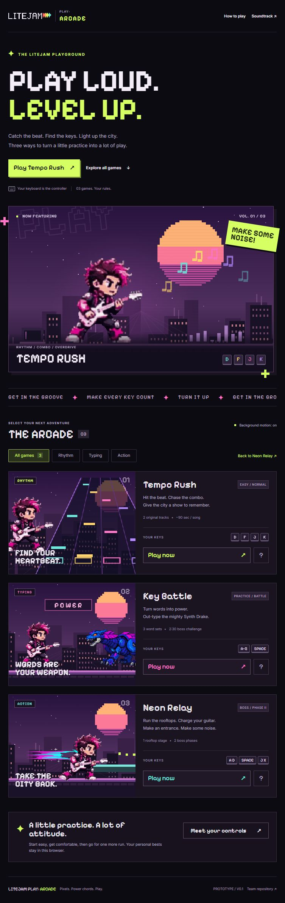

# LiteJam Play: Arcade

Three keyboard games in one local, punk-pixel playground. English UI, the original Punkman and Synth Drake sprites, two original pixel-rock tracks, and a shared game-selection hub.

This is the arcade prototype. **LiteJam Play**, the guitar-practice application, is a separate project.



## Run locally

Requires **Node.js 22 or newer**. No dependencies, npm install, API keys, accounts, or paid generation credits are required to run the games.

```sh
git clone https://github.com/nitikorn20/litejam-play-arcade.git
cd litejam-play-arcade
npm start
```

Open **http://127.0.0.1:8790/**. If that port is occupied, the launcher tries 8791–8799 and prints the actual URL. GitHub access is required to clone this private repository; gameplay works offline afterward.

On Windows, double-click **Start Arcade.cmd** to launch and open the browser. Use **Stop Arcade.cmd** when finished. The launcher only stops the verified server for this project folder. It will not terminate other local projects.

For the portable Windows package, extract the whole ZIP first, then double-click Start Arcade.cmd. It includes a verified Node.js runtime, so no Node installation is needed. Source ZIP users need Node installed.

## Games and controls

| Game | What to play | Controls |
| --- | --- | --- |
| **Tempo Rush** | Neon Heartbeat (120 BPM) or Drake Overdrive (144 BPM), Easy/Normal | D F J K; hold for long notes; Esc pauses; Space/Esc resumes |
| **Key Battle** | English typing practice or a 2:30 boss challenge; three word sets | Type the word, Space submits, Backspace corrects, Esc opens Pause |
| **Neon Relay** | Rooftop action stage and Synth Drake's two boss phases | A/D or arrows move, S/down crouches, Space jumps, J shoots, X slashes, K dashes, L uses the ultimate, P/Esc opens Pause, R restarts |

In Neon Relay, hold J or X to charge. Attacks build the ultimate gauge. Synth Drake transforms at half health. In Key Battle, incorrect submissions and expired battle words trigger counterattacks; danger words hit harder. Use the hub's How to play guide for details.

The Key Battle card also links to the **Scale Flow** demo (`games/key-battle/dist/scale-flow.html`): pick one scale (root, type, R5/R6 position, octave) and play it as a routine of rounds, each round re-ordering the same position with a pattern (up & down, thirds, down & up, scramble) and raising the tempo. Flow set is three rounds (about a minute); Marathon is five (about two). Each note is heard at its real pitch on its beat and when you hit it; a ring on the fretboard drains to the beat and the clock counts the flow down. A round with no miss heals one heart. Free flow has no beat but a 2.5 s pace per note that only breaks the streak. See [Scale Flow rounds](docs/scale-flow-rounds.jpg) and [results](docs/scale-flow-results.jpg).

The same scale engine powers two more demos linked from the hub cards. **Tempo Rush × Scale Flow** (`games/tempo-rush/dist/scale-flow.html`) turns the routine into a falling-note chart: strings 6–5, 4, 3 and 2–1 become the D, F, J and K lanes, every note carries its name and fret, a locally synthesised backing track clicks the beat and plays each note's pitch, and the hit plucks it again. **Neon Relay × Scale Flow** (`games/neon-relay/dist/scale-flow.html`) is a rail runner: Punkman auto-runs across the rooftops while the position arrives as LED notes on six neon rails (the strings); type each note's name (A–G, S or # for a sharp) on the beat and Punkman hops to its string and strums; the Keys switch in the menu restores hopping rails with W/S or the arrows and strumming with J, X or Space. Both keep the rounds, tempo ramp, countdown and per-round results of the Key Battle demo. All three demos have a **Practice · notes wait** mode (no beat: each note waits until you play it, a 2.5 s pace only breaks the streak) and an **Auto run** switch that plays the scale by itself so the effects can be watched; auto runs are never saved as personal bests.

Punkman has a gentle guitar/shoulder idle animation in Key Battle, including before the first keystroke. Pause freezes it; Effects: Reduced disables decorative movement.

Key Battle and Neon Relay open in a large play layout fitted to the browser. Their Pause menus contain instructions, settings and secondary actions; the main screen keeps the information needed during play. Fullscreen is optional. Opening Pause preserves the run and clears held gameplay inputs.

See the updated [Key Battle screen](docs/key-battle-immersive.jpg) and [Neon Relay screen](docs/neon-relay-immersive.jpg).

Desktop keyboards are the primary target. Mobile is a secondary option: Key Battle keeps the current word/input near the native keyboard, while Neon Relay is best in landscape with its touch controls. Audio begins after a user action. Scores and preferences stay in this browser's local storage; there is no cloud sync or leaderboard.

## Develop and check

```sh
npm test
npm run build
```

`test` runs the server/delivery integration tests and all three games' existing mechanics, rhythm, boss, and lifecycle tests. `build` validates local entry routes, assets, JavaScript/JSON syntax and WAV ranges; it does not bundle or download anything. Reload the browser after editing.

```text
public/                    Hub, local fonts, pixel logo, shared shell
games/tempo-rush/dist/      Rhythm game, audio and charts
games/tempo-rush/tests/     Rhythm timing/controller tests
games/key-battle/dist/      Typing engine and battle renderer
games/neon-relay/dist/      Action platformer and boss
scripts/                   Local server, launcher, validation, packaging
tests/                     Server and delivery integration tests
docs/                      Design, handoff and asset notices
```

Each `dist` folder is editable source inherited from a standalone prototype, not generated build output. The server mounts it at `/games/<slug>/`. Game asset paths stay relative to that mount; shared fonts, branding and navigation use `/shared/` and `/assets/`. Every game links back to `/` and cancels audio/input work when leaving the page.

The optional [2D authoring archive](authoring/README.md) preserves the original music composer/scores/MIDI and sprite/VFX recipes and references for future asset work. It is separate from the ready-to-run game and has its own Python/ComfyUI setup requirements. No 3D project or AI model binaries are included.

The local server binds only to loopback. Do not expose it directly as an internet production server. Deployment and multiplayer are outside this prototype's scope.

## Package for the team

```sh
npm run package
```

Creates a source ZIP and checksums in `releases/`. To also produce a Windows x64 portable ZIP, provide a directory containing the official Node.js **24.18.0** `win-x64/node.exe`, its `SHASUMS256.txt`, and `LICENSE`:

```sh
npm run package -- --runtime-dir "path/to/verified-node-runtime"
```

The packager validates the runtime hash against the official release hash and includes Node's license. Runtime binaries, archives, logs, launch-state tokens, and local caches are excluded from Git. Releases are local artifacts; no GitHub Actions or paid hosting is configured.

## Visual identity and rights

Pixelify Sans supplies pixel headings/buttons, with Inter for readable descriptions. Both font files and their SIL Open Font Licenses are bundled locally. The Arcade pixel logo is an SVG drawn for this prototype; the original LiteJam logo remains included unchanged.

This is a **private team handoff**, not a blanket open-source license for LiteJam branding, sprites, or music. See [asset and font notices](docs/THIRD-PARTY-NOTICES.md), [design decisions](docs/design.md), and [contributor guidance](AGENTS.md).

`npm run relocatable` rebuilds `dist-web/`, a copy of the hub and the three games with every link relative, for hosting under any sub-path (the private claude.ai artifact is published from it). It is generated output and stays out of Git.
